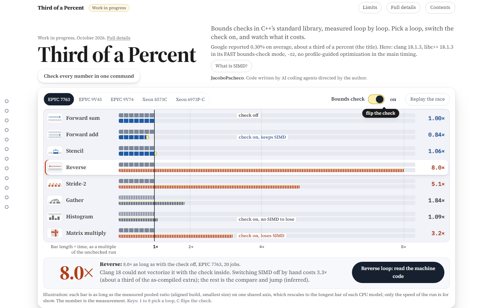

# Third of a Percent

[](https://github.com/JacoboPacheco/third-of-a-percent/actions/workflows/ci.yml)

A loop-by-loop measurement of what libc++ bounds checks cost, set next to Google's 0.30% average, with the machine code as proof.

Status: work in progress (Oct 2026). The measurements described here are the ones so far; the page, notes and results may still change. Code written by AI coding agents directed by the author.



*First screen of the page: EPYC 7763, check on, aligned build, L1. The reverse loop takes 8.0x as long as with the check off.* **Live page: https://jacobopacheco.github.io/third-of-a-percent/** To view it locally instead: `python -m http.server 8000 --directory site`, then open http://localhost:8000.

## In three sentences

1. Google reported that turning on bounds checks in C++'s standard library cost its services 0.30% on average.
2. This study built algorithm kernels and real programs with the checks off and on, timed each pair 20 to 40 times per side in alternating order against an A/A control, and showed from the machine code that the checks were there.
3. The average hides a map. On clang 18, libc++ 18 and `-O2`, loops where the check stops the compiler from using SIMD (reverse, stride-2, matrix multiply) took 2.8 to 8.0 times as long in cache.
   - Forward loops cost little on the AMD models once code placement is controlled (0.82x to 1.06x aligned, one AVX2 exception, 1.11x); below 1x the checked loop ran faster (cause inferred: loop layout). As compiled, the forward add cost about 1.6x on two of the three AMD models.
   - Intel: in all 17 Intel jobs seen (three models; 12 are in the 75-job pool, 3 of the other 5 are on a third model, Xeon 8370C) the forward add at L1 cost 1.05x to 1.20x aligned, against 0.82x to 0.85x on the AMD models. The two pooled Intel models (6 jobs each) have no verdict (INCONCLUSIVE under the written rules): the Xeon 8573C's forward add costs a measured 1.06x, over the 2% forward limit; the Xeon 6973P-C's 1.20x is left out as placement-sensitive, and its stencil at L2 ends at 1.026, over the same limit. See the [details](readme-parts/DETAILS.md).
   - Loops that lose SIMD are rare in the general libraries counted and not rare in the numeric projects (counted, not timed).

**Words used here.**
- **SIMD**: one instruction working on several array elements at once.
- **A/A control**: timing a program against a copy of itself, to see the machine's own noise.
- **NONE / FAST**: the same program built without checks (NONE) and with libc++'s FAST hardening mode (FAST).
- **Verdict**: the per-CPU-model reading, computed from written rules: costs uneven across loop shapes (a "map"), small everywhere, or cannot be called from the data (inconclusive: a mixed picture, too noisy, too few jobs or a failed control).
- **Placement**: the memory address where a loop's code starts; moving it can change speed.
- **Aligned**: every loop's code starts on a 64-byte boundary (`-falign-loops=64`), so differences in where a loop starts are removed from the comparison.
- **Forward sum, forward add**: `s += a[i]` and `c[i] = a[i] + b[i]`, indices counting up.
- **PGO**: profile-guided optimization: the compiler sees a sample run first and tunes to it.

## The question

Google wrote that "Hardening libc++ resulted in an average 0.30% performance impact" across its services ([Google Security Blog, Nov 15 2024](https://security.googleblog.com/2024/11/retrofitting-spatial-safety-to-hundreds.html)). Hardening makes C++'s standard library check every `vector[i]` against the vector's size.

This study timed loops and programs with checks off and on: a different measurement, so it neither confirms nor contradicts Google's average.

## What was found

Some loops lose SIMD when a check is added. A check can stop the program at any element, so the compiler may process several elements at once only if it can show the whole range is in bounds. For forward loops it can (the check moves to the tail); for the reverse and stride-2 loops clang 18 reports that it cannot determine the number of iterations, and for matrix multiply that vectorizing is not beneficial. Compile-only tests narrow the cause (nothing timed; run on Compiler Explorer's clang 18.1.0 release candidate, not the timed Ubuntu 18.1.3). On clang 18, of 29 loops compiled with FAST, all 16 with an iteration count for every exit in the compiler's analysis were vectorized and none of the 13 with an uncounted exit, and hoisting the one check the reverse loop keeps inside it makes it vectorize (observed; that the vectorizer needs the count is inferred from the LLVM source; [reverse and stride-2](investigate/vectorizer/reverse-stride2/README.md)). For matrix multiply the cost model prices each of the two checks at 14 units, so a width-4 vector iteration costs 45 against 44 for four scalar ones (observed; [matrix multiply](investigate/vectorizer/matmul/README.md)).

- **2.8x to 8.0x slower** in cache for loops that lose SIMD (reverse, stride-2, matrix multiply on clang 18), on all three AMD models with a verdict; the two Intel models (6 jobs each, no verdict) lost the same loops, 3.1x to 6.6x. This is the main run; other setups tested separately (`siblings/`) reached about 9.7x at L1. Losing SIMD is only part of the cost: on EPYC 7763 at L1 a build with vectorization switched off by hand takes 3.3x as long for reverse (7.6x with the checks on, as compiled), 2.6x for stride-2 (5.1x) and 1.6x for matrix multiply (3.2x). The rest is presumably the per-element compare and branch (inferred, not isolated).
- **1 of 593** vectorized loops in 19 general libraries lose SIMD, against 444 of 4,968 in 25 numeric projects. Counted, not timed. Of the 593, 443 are inside libc++'s own headers and none of those was lost; counting project code only, it is 1 of 150 against 444 of 1,609. In the numeric set 7 of 25 projects have any lost loop, and LightGBM holds 331 of the 444.
- **Real programs timed whole** (six workloads from four projects picked for their lost loops: LightGBM with three option sets, Draco, tiny-dnn, Spectra): detectably slower for five of the six on EPYC 7763 (1.2% to 7.5%, 16 jobs; three of the four projects), four on EPYC 9V74 (3 jobs), three on EPYC 9V45 (5 jobs); the rest were not detectable. Two control programs without lost loops (meshoptimizer, {fmt}) showed no detectable slowdown.
- **Code placement and PGO.** Across 4 placements the reverse loop stays at 5.2x to 8.0x and the forward sum near 1x; the forward add swings 0.82x to 1.60x on two models (as compiled 1.59x on EPYC 7763 and 1.60x on 9V74, traced to loop layout, not the check's own instructions), and the verdict leaves out the forward cells that depend on placement. PGO, trained on the timed input, left the cost in most rows.
- **0.99x to 1.09x** for the reverse loop after one added size check before it, with the checks still on.
- **GCC differs.** With GCC 14 and libstdc++'s own `_GLIBCXX_ASSERTIONS` (a different library, different checks) at `-O3`, even the forward add loses SIMD and runs 4.9x to 8.5x slower (7 jobs on 3 CPU models; the low end is one job).

## Try it

```
python scripts/check.py
```

Recomputes every interval and verdict from the raw timings and checks the page's data (Python 3, numpy; about 35 minutes on a CI runner and about 55 on one Windows laptop, single-run estimates). The page check also needs `pip install playwright` and `playwright install chromium`; without the package it is skipped.

```
gh workflow run measure.yml
```

Reruns the measurement in your fork (enable Actions in the fork first; `gh run watch`, then `gh run download <id>`; the per-job files are the `results-<cpu>-jN` artifacts, the pooled result is `pooled`).

## How much to trust it

- **Shared machines.** GitHub picks each job's CPU. The kernel pool is 75 jobs in 13 runs (20 to 23 jobs for each AMD model, 6 for each Xeon model); 45 of them come from ten later runs in which 45 of 100 dispatched jobs returned results. All 100 finished their timing step; the other 55 were cancelled at the 22-minute limit during the whole-repository check the workflow then ran, before the upload, and returned nothing (the workflow now uploads first). The cut fell unevenly by CPU model: the 45 that returned are EPYC 9V74 18, EPYC 9V45 15, Xeon 6973P-C 6, Xeon 8573C 5 and EPYC 7763 1 (19 of the first 30 jobs were EPYC 7763), so the later runs add one job to the 7763 pool. The effect of that mix on the ratios was not tested.
- **Mostly one toolchain.** Ubuntu clang 18, libc++, `-O2`, FAST mode. Clang and libc++ 19 to 21, timed on the eight loops (one CPU model with enough jobs), still lose the reverse and stride-2 loops; matrix multiply keeps SIMD there but is not free (1.6x at L1 on EPYC 7763, as slow as a build with no vectorization at all, and 1.15x at L2). A compile-only sweep (`ce-sweep/`, nothing timed) finds matrix multiply lost on clang 16 to 18 at baseline x86-64, kept on 19 to 22 (Ubuntu's own clang 20.1.2 and libc++ 20 agree), and lost again on clang 23.1 and trunk (as served on 2026-10-12). The change is in the compiler, not the library, and clang 19 to 21 price each of the two checks at 1 cost unit where clang 18 prices them at 14 (observed on Compiler Explorer's builds, not the timed ones); that LLVM commit `b6a8f5486b` caused it is inferred, not tested ([study](investigate/vectorizer/matmul/README.md)).
- **Machine state.** Over 10 jobs, steal was 0%, and reported CPU frequency drifted at most 0.57%. The driver was seen on the timed core's hyperthread sibling in 8 jobs.
- **Counts are not time.** The 593 and 4,968 are loops, not hotness.
- **Real programs** (four projects) were picked because they contain lost loops, not sampled.
- **Rules were loosened after seeing results.** The day-one test (the first two runs) judged forward loops by a rule that both runs failed, so the result was no-go as written; the rule was then relaxed in `harness/criteria.json`. The later versions (v2, v3) changed no threshold but added rules (the aligned column, the layout A/A, placement-sensitive cells, pooling per CPU model, 40 repetitions per side) after earlier results were known, so they are not pre-registered. Each rule file was committed before the runs it judges, and all versions are kept.
- **Independence and holdout.** On the 75-job pool a block bootstrap and the other interval methods tried (exploratory, [report](robustness/report.md)) change no verdict form on EPYC 7763, 9V74 or 9V45; the two Xeon models (inconclusive as pooled) become MAP under some of them. A fresh, pre-planned run matched the original 30-job pool on EPYC 7763 and 9V74, not 9V45.

## Where things are

Start with `kernels/` and `site/`; the rest is evidence.

- **Study:** `kernels/` the 8 loops; `programs/` the two small programs (json, fmt) timed in the early runs; `realworld/` the real programs timed whole; `corpus/` the loop census; `harness/` times and judges; `mitigate/` the rewrite that restores SIMD.
- **Runs:** `results/` every run as downloaded (the kernel pool is `s6-pooled`: the 30 jobs of `s4-run-*`, also pooled alone in `s4-pooled`, plus the 45 of `s6-run-*`); `layout-sweep/`, `pgo/`, `versions/`, `environment/`, `robustness/` the follow-up columns, each with its own README or plan; `siblings/` and `ce-sweep/` other compilers and modes; `variants/` a compile-only test of other loop spellings.
- **Evidence and review:** `dayone/` the first test, its rules and raw data; `claims-audit/` dated reports from separate checks of the page figures (some of the scripts are not published); `audit/` a separate audit of the S3 run; `investigate/` why the forward add cost 1.6x and, in `vectorizer/`, why the reverse, stride-2 and matrix-multiply loops lose SIMD (compile-only); `docs/` the day-one result; `gaps/` the related-work table (sources read); `tools/` the `lostloops` tool that lists which loops lose SIMD. The audits and checks were run within the project, by the author's own tooling and AI agents, not by an outside reviewer.
- **Page and checks:** `site/` the page; `readme-parts/` the long version of this README (`DETAILS.md`; the page's own details are `site/details.html`); `scripts/` and `tests/` the one-command check (`python scripts/check.py`).

Method, per-CPU numbers, limits, history: [details](readme-parts/DETAILS.md).
